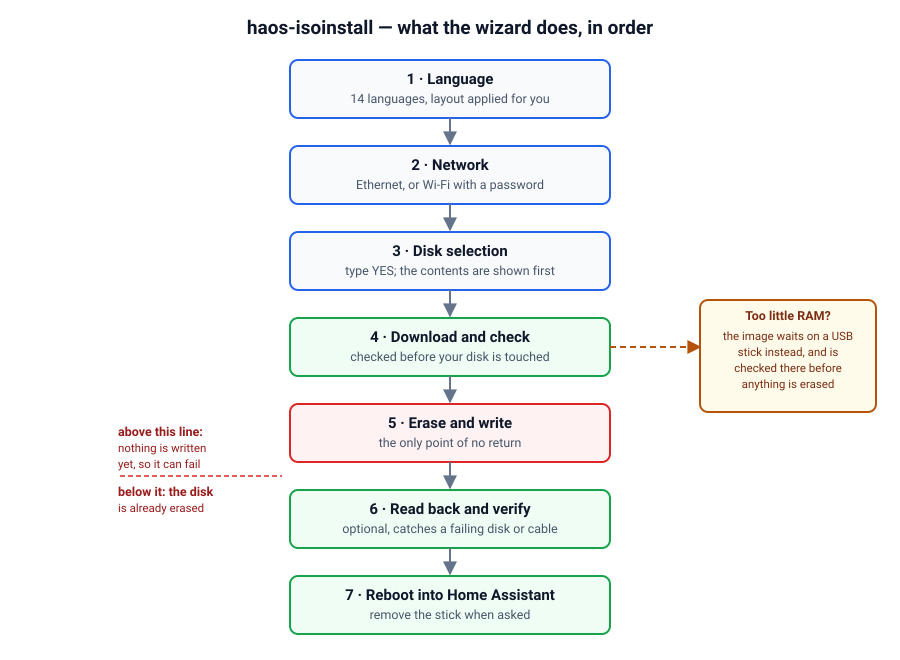

# haos-isoinstall — install Home Assistant OS on a PC, without a command line

[](https://github.com/cronner/haos-isoinstall/actions/workflows/checks.yml)
[](https://github.com/cronner/haos-isoinstall/actions/workflows/build-iso.yml)

Bootable USB stick that installs **Home Assistant OS** on a PC through a guided
wizard: network setup (Ethernet or Wi-Fi), disk selection, download and writing
of the official image. Nothing to type.

It exists to make that install an easy one. The official route hands you a
compressed image and a set of steps; this hands you one stick that asks a few
questions, fetches the current Home Assistant OS image for you, checks it, and
writes it to the disk you choose. Nothing has to be prepared on the target PC
first.

- **The whole installer is on the stick** — network and Wi-Fi firmware, the
  wizard and the language list are already there. The only thing downloaded is
  Home Assistant OS itself.
- **No commands to learn.** Language, network, disk: that is the whole interview.
- **Always the version that is current today.** The image is fetched during the
  installation, so it cannot be the one from last year.
- **It says what it is about to do**, and the single irreversible step — erasing
  the disk you pick — asks first.

**New to Home Assistant?** Follow the [step-by-step guide](https://cronner.github.io/haos-isoinstall/)
instead. It assumes no experience: what you need, six steps, how the first
start goes, and what to do when a step stalls. This page is the reference
manual for people who want the details.

**Quick start** — download the ISO from [Releases] and check it
(`sha256sum -c *.iso.sha256`), write it to a USB stick with Etcher or Rufus (not
by copying the file), turn **Secure Boot off** and SATA to **AHCI** in the BIOS,
boot the stick and follow the wizard. Everything below is detail.

**Contents:** [What you need](#what-you-need) · [1 Download](#step-1--download-the-iso)
· [2 Write the stick](#step-2--write-the-iso-to-the-usb-stick)
· [3 BIOS](#step-3--configure-the-pcs-biosuefi) · [Screens](#what-it-looks-like) · [4 Install](#step-4--install)
· [When RAM is short](#when-ram-is-short--the-image-is-staged-on-a-usb-stick)
· [Unattended](#unattended-installation)
· [5 First boot](#step-5--first-boot) · [Troubleshooting](#if-something-goes-wrong)
· [Building it yourself](BUILDING.md)

The wizard speaks **14 languages**, taken from the countries with the most Home
Assistant installations — the top of
[Home Assistant's public analytics](https://analytics.home-assistant.io/).
German and English are the two largest, but English comes first and Danish second
because this fork started in Danish. Adding a language later is 104 strings to
translate. You pick the language, and its keyboard layout is applied
automatically — one line, nothing to match up:

| Language | Keyboard layout set automatically |
| -------- | --------------------------------- |
| English | QWERTY (United States) |
| Danish | QWERTY (Denmark) |
| Czech | QWERTZ (Czechia) |
| Dutch | QWERTY (Netherlands) |
| Finnish | QWERTY (Finland) |
| French | AZERTY (France) |
| German | QWERTZ (Germany) |
| Italian | QWERTY (Italy) |
| Norwegian | QWERTY (Norway) |
| Polish | QWERTY (Poland) |
| Portuguese | QWERTY (Portugal) |
| Russian | YTsUKEN (Russia) |
| Spanish | QWERTY (Spain) |
| Swedish | QWERTY (Sweden) |

A layout belongs to the keyboard, not to the language, so the last line of the
menu — *Keyboard layout only (another country)* — holds the full set of pairs:
QWERTY (United Kingdom) and QWERTZ (Germany) for English, AZERTY (Belgium),
QWERTZ (Switzerland), QWERTY (Canada) and QWERTY (United States) for French, and
QWERTZ (Switzerland) for German. Nobody else ever sees that line.

Menu labels stay in plain ASCII so they remain readable on the text console; the
translated messages themselves use the language's own characters. A language code
that is not in the table falls back to English and US QWERTY.

The ISO does **not** contain HAOS: the image is downloaded during the
installation ("network install" approach). It therefore stays small (**~450 MB**) and
always installs the **latest published version** of Home Assistant OS. If you already
have that image, you can bring it on a USB stick instead and skip the network
entirely — see [Using an image you already have](#using-an-image-you-already-have).

## ⚠️ READ THIS BEFORE ANYTHING ELSE

> ### This tool COMPLETELY ERASES the disk you select.
>
> No recovery is possible. Use it on a **dedicated** machine,
> **with no data worth keeping**.

**Provided as is, with no warranty and no support.**

- **Personal** project, published in the hope that it is useful. Nothing more.
- **Written with AI assistance.** The code, this documentation and the fourteen
  translations were produced with AI help and checked by automated tests, not by
  a support team. Expect mistakes, and read a step before you run it.
- **No support is provided.** No installation assistance, no promise of an
  answer to issues, no commitment to fix anything, no long-term maintenance, no
  promise of hardware compatibility.
- **No liability** is accepted for data loss, unusable hardware or any other
  damage. See [LICENSE](LICENSE).
- **Not happy with this project? Fork it.** It is an MIT licence, that is what
  it is for. You are free to modify it, improve it, redistribute it and
  maintain it your own way, without asking anyone.

By using this tool, you accept that you alone bear the consequences.

**Unofficial project** — not affiliated with the Open Home Foundation, Nabu Casa
or the Home Assistant project, and neither approved nor supported by them. The
officially supported method is described
[here](https://www.home-assistant.io/installation/generic-x86-64/). For any
problem with **Home Assistant itself**, turn to the Home Assistant community —
not to this repository.

---

# Installing Home Assistant

## What you need

- A **x86-64 PC with UEFI** — the ISO is 64-bit only, and Home Assistant needs
  UEFI (no Legacy/CSM mode, see step 3)
- A PC **dedicated** to Home Assistant — **its disk will be completely erased**
- **32 GB of disk** minimum, **2 GB of RAM** minimum
- A **USB stick** of 1 GB or more (its contents will be erased)
- An **Ethernet cable** — recommended; Wi-Fi is offered as a fallback

It also works in a **virtual machine**, and every hypervisor with UEFI firmware
behaves the same way: attach the ISO as a virtual CD/DVD, boot it **UEFI** with
**Secure Boot off**, and give the VM a **32 GB** virtual disk or more.

- **Proxmox** — machine type `q35`, firmware **OVMF**
- **Unraid** — an ordinary QEMU/KVM VM with **OVMF** firmware
- **virt-manager / libvirt, Incus, LXD** — firmware **UEFI (OVMF)**

Use a **virtual Ethernet adapter**: Wi-Fi pre-configuration does not apply to a
VM. For a long-lived hypervisor install the official `haos_ova` image is the
better fit — it ships as `.qcow2`, `.vmdk`, `.vhdx`, `.vdi` and `.ova`, which is
what Home Assistant supports there; the ISO works, but it writes the bare-metal
image. The reasoning is in [the technical notes](BUILDING.md#5-technical-notes).

## Step 1 — Download the ISO

**[⬇️ Download the latest version](https://github.com/cronner/haos-isoinstall/releases/latest)**

Take the `.iso` file from the *Assets* section. The `.sha256` file next to it
lets you check that the download is not corrupted (optional):

```bash
sha256sum -c haos-isoinstall-*.iso.sha256
```

## Step 2 — Write the ISO to the USB stick

With one of these tools, your choice:

- **[Balena Etcher](https://etcher.balena.io/)** — the simplest, Windows/macOS/Linux
- **[Rufus](https://rufus.ie/)** — Windows
- **[Ventoy](https://www.ventoy.net/)** — simply copy the `.iso` onto the stick
- **Linux, from the command line**:
  ```bash
  sudo dd if=haos-isoinstall-*.iso of=/dev/sdX bs=4M status=progress conv=fsync
  ```
  ⚠️ Check `/dev/sdX` with `lsblk` — a mistake here erases the wrong disk.

## Step 3 — Configure the PC's BIOS/UEFI

This is **the step everybody trips over**. Power on the PC and immediately press
`Del`, `F2`, `F10` or `Esc` (depending on the brand):

1. **Boot mode: UEFI** — not "Legacy", not "CSM"
2. **Secure Boot: DISABLED** ← *mandatory, Home Assistant will not boot otherwise*
3. **SATA mode: AHCI** — not "RAID", not "Intel RST". With RST the disk is
   hidden from the installer, and Home Assistant will not find it afterwards
4. **Fast Boot: OFF** — recommended: it makes the first boot from the stick
   unreliable on some firmware
5. **USB stick first** in the boot order
6. **"Power on after power loss" / "AC recovery": ON** — recommended: a Home
   Assistant box that stays off after a power cut is a box you have to go and
   switch on by hand, every time
7. Save and exit (`F10`)

Once Home Assistant boots on its own, put the **internal disk first** in the boot
order again. The wizard does recreate a `HAOS` UEFI entry, but the stick would
otherwise keep priority and start the installer again.

## What it looks like

Text mock-ups of the real screens, so you know what to expect. The wording is
the wizard's own; only the disk details are made up.

**1. Language** — one line per language, and the keyboard layout is applied with
it, so there is nothing to match up. The last line opens the full set of layouts
for keyboards that do not match their language (a US keyboard with French,
British English, Swiss German).

```
┌─ Language & keyboard ──────────────────────────────────────────────────┐
│ Choose your language. Its keyboard layout is set automatically.        │
│                                                                        │
│ The last line is for a keyboard from another country.                  │
│                                                                        │
│ ▶ English    — QWERTY   (United States)                                │
│   Dansk      — QWERTY   (Denmark)                                      │
│   Cestina    — QWERTZ   (Czechia)                                      │
│   Nederlands — QWERTY   (Netherlands)                                  │
│   Suomi      — QWERTY   (Finland)                                      │
│   French     — AZERTY   (France)                                       │
│   Deutsch    — QWERTZ   (Germany)                                      │
│   Italiano   — QWERTY   (Italy)                                        │
│   Norsk      — QWERTY   (Norway)                                       │
│   Polski     — QWERTY   (Poland)                                       │
│   Portugues  — QWERTY   (Portugal)                                     │
│   Russkiy    — YTsUKEN  (Russia)                                       │
│   Espanol    — QWERTY   (Spain)                                        │
│   Svenska    — QWERTY   (Sweden)                                       │
│   Keyboard layout only (another country)                               │
│                                                                        │
│                          <Ok>       <Cancel>                           │
└────────────────────────────────────────────────────────────────────────┘
```

**3. Disk** — the current contents are listed above the question, and the answer
has to be typed, so a button cannot erase a disk by accident.

```
┌─ ⚠  FINAL CONFIRMATION  [4/6] ─────────────────────────────────────────┐
│ Disk /dev/sda will be COMPLETELY ERASED.                               │
│                                                                        │
│ Current contents detected:                                             │
│    sda                                                                 │
│    ├─sda1     512M  vfat                                               │
│    └─sda2     460G  ext4                                               │
│                                                                        │
│ Type YES (in capitals) to erase it and install                         │
│ Home Assistant OS.                                                     │
│ Any other answer stops here, with nothing erased.                      │
│                                                                        │
│ YES                                                                    │
│                                                                        │
│                          <Ok>       <Cancel>                           │
└────────────────────────────────────────────────────────────────────────┘
```

**4. Download** — with too little RAM the image is staged on a USB stick instead,
and the dialog says so before anything is touched.

```
┌─ ⚠  WARNING  [5/6] ────────────────────────────────────────────────────┐
│ Not enough free memory to hold the image in RAM (429M).                │
│                                                                        │
│ No writable stick or external disk with that much free space           │
│ was found.                                                             │
│                                                                        │
│ Plug one in and choose Retry: the image is downloaded there            │
│ and checked BEFORE anything is erased.                                 │
│                                                                        │
│ "Write in one pass" instead erases the target disk first:              │
│ a network drop after that leaves an empty disk.                        │
│                                                                        │
│                   <Retry>       <Write in one pass>                    │
└────────────────────────────────────────────────────────────────────────┘
```

The whole sequence, and the one line that matters in it:



Everything above the red line can fail without costing you anything. Everything
below it has already erased the disk.

Real screenshots would have to come from a virtual machine: boot the ISO at 80×24
and capture each step. The mock-ups above are checked by hand whenever the wording
changes; screenshots would have to be checked too, which is why there are none yet.

## Step 4 — Install

Plug in the stick, boot. The wizard starts on its own:

1. Welcome screen and reminders
2. Language — 14 languages, each with its keyboard layout applied (table above)
3. **Where the image comes from** — download the latest version (default), or use
   one you already have on a USB stick. The second needs no network at all; see
   [Using an image you already have](#using-an-image-you-already-have).
4. Network connection — automatic over Ethernet, otherwise Wi-Fi selection
5. **Disk selection** — check the size and model; the current contents are
   displayed, and you must type `YES` to confirm (anything else stops)
6. Download and integrity check, **then** erasing and writing — each with its
   own progress bar (percentage, rate, ETA). The image is fetched and verified
   before the disk is touched, so a network failure leaves the disk intact, and
   an interrupted download resumes instead of starting over.
   On a machine with too little RAM the image is staged on a USB stick instead —
   see *When RAM is short* below.
   **Do not power off the PC**
7. **Read-back check** — optional, and recommended. The wizard offers to read
   the written bytes back off the disk and hash them, then compare that hash
   with the hash of the image it wrote. The page cache is dropped first, so it
   reads the disk and not RAM. One to three minutes. This is how a worn SSD, a
   marginal SATA cable or bad memory is caught *now* rather than as a machine
   that boots to a black screen. If the two hashes differ the wizard stops and
   tells you not to use the installation; declining the check is allowed and
   changes nothing else.
   It proves the copy is correct today; it cannot promise the disk will still be
   correct next year.
8. **Remove the USB stick**, then confirm: the PC reboots straight into Home
   Assistant. The installer runs from memory, so the stick is no longer needed
   at this point.

Lines of text scroll by during boot: that is normal, it has not crashed.

## When RAM is short — the image is staged on a USB stick

The wizard keeps the downloaded image off the target disk until it has been
checked, so a failed download cannot cost you a disk. That needs room for the
compressed image (~430 MB) plus headroom — about twice its size in free memory,
because it stages it in RAM, and `/tmp` is a tmpfs, half of RAM by default.

Below that, the wizard does not silently drop the guarantee:

1. It says how much memory is free and asks for a **writable USB stick or
external disk** with at least as much free space (FAT32, exFAT, NTFS and ext4 all
work), then offers **Retry**.
2. Once one is found it shows the exact path it will use, downloads there,
checks the file against the image's `.xz` checksums, and only then erases the
disk.
3. The file is deleted from the medium and the medium unmounted again once the
write is done, so a stick you plugged in for this is left as you gave it.

It never uses the installer stick itself: that one carries a read-only ISO9660
filesystem, and writing there would mean reformatting it — destroying the only
way back into the installer before Home Assistant is installed. The installation
disk and the boot medium are excluded too; only USB or external media qualify.

With no such medium, the last button is **Write in one pass**: the target disk is
erased first and the download and the writing happen in one stream, so a network
drop at that point leaves an empty disk. The dialog spells that out before you
pick it.

The choice of medium — what qualifies and what must be refused — is tested by
`tests/stage.sh` (internal disk, installation disk, boot medium,
ISO9660/UDF, too little room, read-only mount, and which candidate wins).

## Using an image you already have

The wizard asks where the image should come from before it touches the network:

- **Download the latest version** (default) — what the rest of this page describes.
- **Use an image on a USB stick** — for a machine with no network, or to install a
  version you already have.

The second route skips the network and the version lookup entirely. Plug in the
stick holding the file (FAT32, exFAT, NTFS and ext4 all mount) and the wizard
scans removable media, up to two folders deep, for `*.img.xz`. The stick is
mounted **read-only**: nothing on it is written, renamed or deleted.

Only `haos_generic-x86-64-<version>.img.xz` — the name Home Assistant itself
publishes — is offered. A file built for another board (`haos_rpi4-64-…`,
`haos_odroid-n2-…`, `haos_generic-aarch64-…`) is listed as unusable together with
the board it was built for, because writing it would erase the disk and produce
something that boots nothing. The separator in the name is not a trap either:
`generic-x86_64` and `generic-x86-64` are read as the same board.

If several images are found, you pick one from a list showing each path and size.
The chosen file is then verified with its own `.xz` checksums **before** anything
is erased, exactly as a download would be; a damaged file stops there with the
disk untouched.

What this route cannot tell you is where the file came from. The `.xz` check
proves it is intact, not that it is genuine: if you did not get it from the
[official releases](https://github.com/home-assistant/operating-system/releases),
that judgement is yours. The read-back check afterwards still proves that the copy
written to the disk is correct.

The media scan and the name gating are covered by `tests/image.sh`: target disk,
boot medium, internal disk, iso9660/UDF, a file in a folder, a wrong board, two
versions, and an already-mounted stick.

## Unattended installation

For a machine with no screen and no keyboard attached — a mini-PC in a cupboard,
or a VM you would rather rebuild than click through. It is **opt-in twice**: the
wizard runs as usual unless something asks for unattended mode, and even then it
refuses to erase a disk unless `WIPE=yes` was written down. Booting this ISO and
pressing Enter still gives you the normal wizard.

There are two ways to ask for it:

1. **A file on a USB stick** — `haos-installer.cfg`, in the root of the stick
   (FAT32, exFAT, NTFS and ext4 all work). Plug it in before booting.
2. **The kernel command line** — add `haos.unattended=yes` to the boot entry, for
   a VM or a network boot where there is no stick to put a file on. The keys
   below work with the same names: `haos.disk=/dev/sda`, `haos.wipe=yes`,
   `haos.lang=da`, and so on.

The ISO carries a template for the file: `haos-installer.cfg` in its root, every
key commented out, and a copy named `haos-installer.cfg.example` in
`/usr/local/share/doc/haos-isoinstall/` on the running system. A file that sets
nothing is not a config, so it is skipped and the log says so -- and it cannot be
edited where it sits: the partition carrying the live system is iso9660, which is
read-only whether the image went to a disc or to a stick.

On a USB stick that leaves three ways: a data partition on the same stick
(Ventoy, or a stick partitioned by hand) with the file in its root -- the
installer searches the boot stick's own partitions, but never the iso9660 one; a
second stick, as above; or the kernel command line, which needs nothing prepared.

The file is plain text, one `KEY=value` per line, `#` starts a comment, and a
file saved on Windows with CRLF line endings is fine:

```ini
# Mini-PC in the basement, reinstalled from a stick.
UNATTENDED=yes
WIPE=yes
DISK=/dev/nvme0n1
LANG=da
POWEROFF=yes

# Optional: the image next to this file -> no network needed at all.
IMAGE=haos_generic-x86-64-18.1.img.xz
```

| Key | Meaning |
| --- | --- |
| `UNATTENDED=yes` | **Required.** Without it the file is ignored and the wizard runs. |
| `WIPE=yes` | **Required.** This is the typed `YES` of the normal wizard: consent to erase. Without it nothing is erased and the run stops. |
| `DISK=/dev/nvme0n1` | The target. Leave it out and the only eligible disk is used; two eligible disks stop the run instead of guessing. |
| `IMAGE=…img.xz` | An image in the same folder as the config file. Skips the download and the network entirely. |
| `LANG=da` | One of the 14 languages; its keyboard layout is applied. Default: English. |
| `KEYBOARD=dk` | Override the layout on its own: `layout` or `layout\|variant` (`fr\|ch`). |
| `POWEROFF=yes` | Power the PC off when done instead of rebooting into Home Assistant. |
| `FORMAT=yes` | Allow the installer stick to be reformatted at the end, as the wizard offers. Off by default: it is the only way back into the installer. |
| `STREAM=yes` | Allow the one-pass write when RAM is too small and there is no medium to stage the image on. That write erases the disk **before** the download is checked; off by default. |

What it does on its own: skips the language, welcome and image-source screens,
waits up to 20 s for an Ethernet link, resolves the version, picks the disk, then
shows the same progress screens as the wizard. It always runs the read-back check
at the end — minutes nobody is there to spend, but also nobody is there to notice
a disk that does not match.

The stick that carries the config file is not a candidate either: it is a medium,
not a target, so a small stick next to the SSD still reads as one disk.

What it refuses to do, and why: erase without `WIPE=yes`; pick between two usable
disks; accept a `DISK=` that the wizard would not have offered (the boot medium,
the stick holding the image or the config, a Ventoy stick, anything carrying an
ISO); write to a disk under 32 GB; download when there is no network and no local
image; and use the destructive one-pass write unless `STREAM=yes` says so.

If anything fails, the log is copied to a stick if one is mounted, the reason is
printed on screen, and the PC powers off after 20 seconds rather than waiting for
a keypress. Every decision is in the log, including which disk was chosen and why
the others were not.

The config parsing and the disk eligibility rules are covered by
`tests/unattended.sh`: CRLF and quoted values, lowercase keys, unknown keys,
comments, `WIPE` never assumed, and the same exclusions the menu applies.

Watching a whole run in a VM, and the negative tests that prove the guards, are
described in [BUILDING.md §3.1](BUILDING.md#31-testing-unattended-mode).

## Step 5 — First boot

Leave the network cable plugged in and **wait 2 to 5 minutes**: Home Assistant
finishes its installation, the screen may look frozen. Then, from another
device on the same network:

```
http://homeassistant.local
```

If that address does not answer, use the IP address shown on the PC's screen:
`http://<ip-address>`

> Since Home Assistant Core 2026.8, new installations listen on port 80 instead
> of 8123. If your installation is older, add `:8123` to the address.

## If something goes wrong

| Symptom | Likely cause |
|---|---|
| No disk appears in the wizard | SATA mode set to RAID / Intel RST, which hides the disk from the installer. Set **AHCI** (step 3) |
| The stick does not boot | Secure Boot still enabled, or Legacy/CSM mode instead of UEFI |
| Home Assistant does not boot after installation | Secure Boot still enabled; on a physical PC, SATA mode set to RAID/Intel RST instead of **AHCI** |
| Wi-Fi works during the install but HA is offline afterwards | The Wi-Fi card is not included in Home Assistant OS (narrower firmware coverage than the installer). Use Ethernet. |
| Installation interrupted while writing | The Internet connection dropped during the download. The wizard gives up after 30 s without throughput and says so; starting the installation over from scratch is safe |
| Installation failed | A log is written to `/tmp/haos-install.log`. The wizard offers to copy it to the stick (reformatted), to another USB stick, or to display it on screen. It then powers the PC off |

**Wi-Fi coverage**: Intel, Realtek, Atheros and Broadcom. Ethernet remains the
reliable path. The installation log gives the exact driver of your card and the
`key-mgmt` used: that is what to look at if Home Assistant stays offline.

**Wi-Fi handover to Home Assistant** — the wizard copies the network profile you
just used into the image, including one created through manual configuration
(`nmtui`): hidden SSID, static IP and WPA3 are therefore carried over as they
are. Two exceptions, reported on screen rather than left unsaid: a
**corporate network with certificates** (802.1X with certificate files) cannot
be handed over, since those files do not exist in Home Assistant; and a profile
whose password is not stored in the file cannot be either. In those cases
nothing is written — better that than a network that never comes up — and the
configuration is done afterwards from the Home Assistant console, or over an
Ethernet cable.

### Test status

| Setup | Status |
|---|---|
| Physical PC (x86-64, UEFI) | ✅ |
| Proxmox (q35 + OVMF, Secure Boot off) | ✅ |
| Unraid (QEMU/KVM, OVMF, Secure Boot off) | ✅ reported |
| virt-manager / libvirt, Incus, LXD | ◻ same settings, not tested here |
| Hyper-V, VirtualBox | — use the official `haos_ova` (`.vhdx` / `.vdi`) |

✅ seen working · ◻ expected to work with the settings above, but not tried

**Network:** a LAN cable is the preferred connection — it is what always works.
Wi-Fi works too, and the physical test above was run over it.

## Building it yourself

Auditing, modifying or building the ISO from source — with the technical notes,
the credits and the licence — lives in **[BUILDING.md](BUILDING.md)**. None of it
is needed to install Home Assistant.

This project is MIT-licensed: see [LICENSE](LICENSE).
